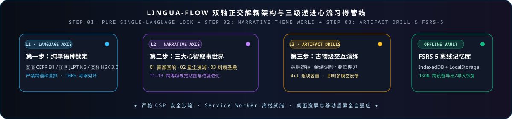

<div align="center">



# Lingua-Flow · 心流语境 (`Lingua-Flow-UI`)

**基于 FSRS-5 记忆稳定性算法、认知负荷理论与三大沉浸式叙事世界的多语种（英 / 日 / 汉）外语习得门户**

[](https://lingua.evotensor.dev)
[](https://qqddtt.github.io/Lingua-Flow-UI/)
[](#)
[](LICENSE)

</div>

---

## ✨ 门户简介与双轴正交解耦设计

本仓库（`Lingua-Flow-UI`）是 **Lingua-Flow（心理学与游戏化外语习得平台）** 的公开纯静态前端门户，线上访问入口为 [https://lingua.evotensor.dev](https://lingua.evotensor.dev)（备用镜像：[https://qqddtt.github.io/Lingua-Flow-UI/](https://qqddtt.github.io/Lingua-Flow-UI/)）。

平台采用**「语种标准轴 × 心智叙事轴」双轴正交解耦架构**与**三级递进页面体系**：
1. **L1 一级主页（[`index.html`](index.html)）**：先行锁定单一目标学习语言（🇬🇧 英语 **CEFR B1** / 🇯🇵 日语 **JLPT N5** / 🇨🇳 汉语 **HSK 3.0**），再选择心智叙事主题，彻底杜绝多语种混排带来的认知干扰。
2. **L2 二级主题主页（[`deductive.html`](deductive.html) / [`immersive.html`](immersive.html) / [`strategic.html`](strategic.html)）**：基于 `1fr : 1.618fr` 黄金比例主从双舞台展示当前绑定语种下的专属章节、难度分级、五维光学色域切换与 Z-01 规则抽屉。
3. **L3 三级古物交互演练舱（[`learn.html`](learn.html)）**：采用 `100dvh` 零纵向滚动壳层与 `Z-03` 恒定画幅幻灯片甲板（`CLS = 0`），围绕六大博物馆级交互古物开展可理解性输入与长效记忆锚定。

<div align="center">
  
</div>

---

## 🎭 三大心智叙事世界与交互古物矩阵

| 叙事世界 | 二级/三级页面入口 | 心智模型与视觉风格 | 核心交互古物与语言习得机制 |
| :--- | :--- | :--- | :--- |
| **🕵️ 01 · 雾都回响** | [`deductive.html`](deductive.html) | **高逻辑反思心智** · 蒸汽黄铜与法庭卷宗 | **【蔡司黄铜显微透镜】**（词根词源拆解）+ **【法庭矛盾指控针】**（证词时态、虚拟语气与助词破绽击穿）。 |
| **🌌 02 · 星尘漫游** | [`immersive.html`](immersive.html) | **低压共情心智** · 24K 金缮与异星深空 | **【24K 金缮声波调频盘】**（日语 Pitch Accent 音高与汉语四声调值谐振）+ **【青苔汝窑螺钿拓印台】**（汉字象形会意字源共鸣）。 |
| **⚔️ 03 · 刻痕圣殿** | [`strategic.html`](strategic.html) | **胜任感驱动心智** · 哥特玫瑰花窗与符文 | **【果冻 SSS 动词变位榫卯】**（五段动词/屈折词尾卡榫拼装）+ **【六翼玫瑰花窗星轨盘】**（复杂从句语序旋转破盾）。 |

---

## 💾 客户端离线持久化与多终端适配特性

- **IndexedDB + LocalStorage 双写容灾（`LinguaFlowDB`）**：学习进度、通关章节与 FSRS-5 记忆卡（稳定性 $S'$、难度 $D'$、可提取性 $R$）100% 自动保存在本地客户端，支持在首页一键**导出 JSON 进度备份**或**跨设备导入恢复**。
- **Service Worker 离线就绪与严格 CSP 防线**：内置 `sw.js` 离线缓存与严格 `Content-Security-Policy` 安全头，断网环境下依然可流畅复习全部三语种案卷。
- **五维明暗色域与全终端适配**：内置 `S1 日光白瓷`、`S2 汝窑暖素`、`S3 羊皮暖砂`、`S4 北欧雾灰` 与 `S5 黑曜暗夜` 五套光学色域，全面兼容桌面宽屏（`1920×1080`）、平板（`1024×768`）与手机竖屏（`393×852` / `360×640`），满足零横向滑溢与 $\ge 44\times 44\text{px}$ 安全触控标准。

---

## 🚀 本地离线运行说明

本仓库为 **100% 纯静态零依赖前端产物**：

```powershell
# 推荐通过任意本地轻量 HTTP 服务器启动（支持 fetch 加载本地 JSON 语料分片与注册 Service Worker）：
python -m http.server 8080
# 随后在浏览器打开 http://localhost:8080
```

---

## 📄 许可证声明 (License)

本公开仓库（`Lingua-Flow-UI`）发布的脱敏纯静态前端代码与 SVG 视觉组件遵循 **[MIT License](LICENSE)** 开源授权。
